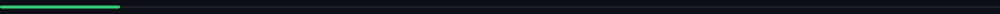

  

  Computer Science student at the University of Ghana · Accra, Ghana 
  Software Engineering · Python Development · Growing interest in AI Engineering

  
  
  

<h2></h2>

I am a BSc Computer Science student at the University of Ghana (expected graduation: 2028), based in Accra. I enjoy building practical tools, mostly in Python and JavaScript, and I am focusing on software engineering and Python development.

I build projects to learn how real software works: calling APIs, handling errors, writing tests and deploying what I make. Over time I want to move towards AI engineering.

<h2></h2>

**Languages** &nbsp; Python · Java · JavaScript · HTML · CSS

**Frontend** &nbsp; React (project experience)

**Backend and data** &nbsp; REST APIs · GitHub API · MySQL / database fundamentals

**Tools** &nbsp; Git · GitHub

**Core concepts** &nbsp; Data Structures and Algorithms · Object-Oriented Programming

  

<h2></h2>

A web app that analyses any public GitHub profile using the GitHub REST API. It shows profile details, language breakdown, repository statistics, top repositories and a searchable repository list. It also includes a Python terminal version.

[Live demo](https://github-developer-analytics.netlify.app) · [Source code](https://github.com/isaad-ui/github-developer-analytics)

A tool that checks whether a website is up. It reports the HTTP status code, response time and timestamp, and handles timeouts, SSL errors and connection failures. It started as a Python script and now has a FastAPI backend, a React dashboard with check history, and automated tests that run in GitHub Actions.

[Live demo](https://website-uptime-monitor.netlify.app) · [Source code](https://github.com/isaad-ui/website-uptime-monitor)

More of my work, including HTML/CSS practice projects and a Java OOP repository, is on my [repositories page](https://github.com/isaad-ui?tab=repositories).

<h2></h2>

  

  

  

<h2></h2>

- Build stronger Python projects with databases, authentication and tests
- Get a software engineering internship
- Improve my problem-solving with data structures and algorithms
- Learn machine learning fundamentals and build a small AI project

<h2></h2>

- LinkedIn: [issaka-sa-ad-timbilla](https://www.linkedin.com/in/issaka-sa-ad-timbilla/)
- GitHub: [isaad-ui](https://github.com/isaad-ui)

I am open to internships and collaboration on small projects. Feel free to get in touch on LinkedIn.
