  

  
  

  <a href="https://github-developer-analytics.netlify.app"><b>Live demo</b></a> &nbsp;·&nbsp; <a href="https://github.com/isaad-ui/github-developer-analytics"><b>Source code</b></a>

  <a href="https://website-uptime-monitor.netlify.app"><b>Live demo</b></a> &nbsp;·&nbsp; <a href="https://github.com/isaad-ui/website-uptime-monitor"><b>Source code</b></a>

  

  

  

  <a href="https://www.linkedin.com/in/issaka-sa-ad-timbilla/"><b>LinkedIn</b></a> &nbsp;·&nbsp; <a href="https://github.com/isaad-ui"><b>GitHub</b></a>

