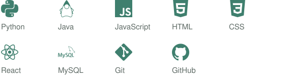
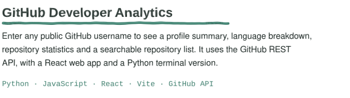
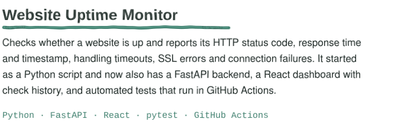
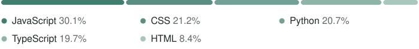

<picture>
  <source media="(prefers-color-scheme: dark)" srcset="./assets/profile/header-dark.svg">
  
</picture>

BSc Computer Science student at the University of Ghana, interested in Python, backend engineering and, over time, AI engineering.

<picture>
  <source media="(prefers-color-scheme: dark)" srcset="./assets/profile/typing-dark.svg">
  
</picture>

<h2><picture><source media="(prefers-color-scheme: dark)" srcset="./assets/profile/h-about-dark.svg"></picture></h2>

I'm a Computer Science student in Accra. I'm interested in Python development and backend engineering, and I learn best by building practical software that I can run, test and improve.

Over time I want to grow towards AI engineering. For now I'm focused on strong fundamentals: data structures, databases and clean code with tests.

University of Ghana · BSc Computer Science · Expected graduation 2028

<h2><picture><source media="(prefers-color-scheme: dark)" srcset="./assets/profile/h-tech-stack-dark.svg"></picture></h2>

<picture>
  <source media="(prefers-color-scheme: dark)" srcset="./assets/profile/stack-dark.svg">
  
</picture>

Also: REST APIs, the GitHub API, data structures and algorithms, object-oriented programming and database fundamentals.

<h2><picture><source media="(prefers-color-scheme: dark)" srcset="./assets/profile/h-featured-projects-dark.svg"></picture></h2>

<a href="https://github.com/isaad-ui/github-developer-analytics"><picture><source media="(prefers-color-scheme: dark)" srcset="./assets/profile/project-github-developer-analytics-dark.svg"></picture></a>

[Repository](https://github.com/isaad-ui/github-developer-analytics) · [Live demo](https://github-developer-analytics.netlify.app)

<a href="https://github.com/isaad-ui/website-uptime-monitor"><picture><source media="(prefers-color-scheme: dark)" srcset="./assets/profile/project-website-uptime-monitor-dark.svg"></picture></a>

[Repository](https://github.com/isaad-ui/website-uptime-monitor) · [Live demo](https://website-uptime-monitor.netlify.app)

More of my work is on my [repositories page](https://github.com/isaad-ui?tab=repositories).

<h2><picture><source media="(prefers-color-scheme: dark)" srcset="./assets/profile/h-currently-learning-dark.svg"></picture></h2>

<picture><source media="(prefers-color-scheme: dark)" srcset="./assets/profile/bullet-dark.svg"></picture> Backend development with Python, including REST APIs

<picture><source media="(prefers-color-scheme: dark)" srcset="./assets/profile/bullet-dark.svg"></picture> MySQL and database fundamentals

<picture><source media="(prefers-color-scheme: dark)" srcset="./assets/profile/bullet-dark.svg"></picture> Data structures and algorithms

<picture><source media="(prefers-color-scheme: dark)" srcset="./assets/profile/bullet-dark.svg"></picture> Machine learning basics, as a first step towards AI engineering

<h2><picture><source media="(prefers-color-scheme: dark)" srcset="./assets/profile/h-github-activity-dark.svg"></picture></h2>

<picture>
  <source media="(prefers-color-scheme: dark)" srcset="https://raw.githubusercontent.com/isaad-ui/isaad-ui/output/github-snake-dark.svg">
  
</picture>

<picture>
  <source media="(prefers-color-scheme: dark)" srcset="https://streak-stats.demolab.com?user=isaad-ui&hide_border=true&background=00000000&stroke=20282B&ring=75B9A8&fire=75B9A8&currStreakNum=DCE5DF&sideNums=DCE5DF&currStreakLabel=75B9A8&sideLabels=A9B5B0&dates=A9B5B0">
  
</picture>

Languages across my public repositories:

<picture>
  <source media="(prefers-color-scheme: dark)" srcset="./assets/profile/languages-dark.svg">
  
</picture>

<h2><picture><source media="(prefers-color-scheme: dark)" srcset="./assets/profile/h-connect-dark.svg"></picture></h2>

<a href="https://www.linkedin.com/in/issaka-sa-ad-timbilla/"><picture><source media="(prefers-color-scheme: dark)" srcset="./assets/profile/icon-linkedin-dark.svg"></picture> LinkedIn</a>
&nbsp;&nbsp;&nbsp;
<a href="https://github.com/isaad-ui"><picture><source media="(prefers-color-scheme: dark)" srcset="./assets/profile/icon-github-dark.svg"></picture> GitHub</a>

I'm open to internships and to collaborating on small projects. LinkedIn is the best way to reach me.
